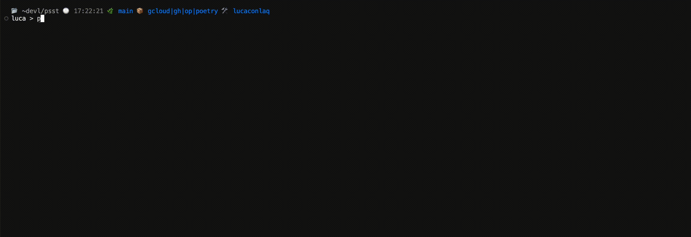

# psst

<p align="center">
  
</p>

A secret management tool that helps you manage and inject secrets into your environment. Supports [1Password CLI](https://developer.1password.com/docs/cli/), [Vault](https://developer.hashicorp.com/vault), Terraform outputs, shell commands, and manual values. All providers are available by default.

**2.0.0-beta.1 is a complete rewrite in Rust** of the original npm-distributed JavaScript/TypeScript application. This is a prerelease: development and testing will continue through additional betas before the stable **2.0.0** release.



## 📦 Installation

Installation instructions for the Rust rewrite using [mise](https://mise.jdx.dev) are coming soon.

## 🚀 Usage

### Interactive Console

Open the interactive console to manage your secrets:

```bash
psst
```

### Run Commands with Secrets

Run any command with your secrets injected into its environment:

```bash
psst <any command>
```

### Examples

```bash
# Open a shell with secrets
psst zsh

# Run a development server
psst npm run dev

# View injected secrets
psst env

# Use secrets in a shell command
psst sh -c 'echo $A_SECRET'
```

## ⚙️ Configuration

psst looks for a config file in this order:

1. Use `PSST_CONFIG` if it is set.
2. Look for `psst.json` or `.psst.json` in the following locations:
   - Current directory
   - Parent directories (up to and including the home directory)
3. If no configuration file is found, use `psst.json` in the current directory.

Existing `.psst.json` files remain supported; `psst.json` takes priority when both exist in the same directory.

If the file does not exist, it will be created when the first secret is added via the console.

Example config:

```json
{
  "API_KEY": {
    "source": "op",
    "value": "op://vault/item/field"
  }
}
```

Terraform references use `directory#output_name`, with the directory relative to the config file. For example:

```json
{
  "TF_SECRET": {
    "source": "terraform",
    "value": "terraform-directory#output_name"
  }
}
```

psst runs `terraform output -json` in that directory and selects the named output.

## Adding providers

Providers live in separate modules under `src/providers/`, with a shared interface for fetching, editor labels, and optional browsing. Registration is centralized in `src/providers/mod.rs`; adding a provider does not require changing the UI. See [the provider guide](docs/PROVIDERS.md).

## 🛠️ CI and releases

Every branch push and pull request runs formatting and Clippy checks, tests, and release builds for Linux and macOS on both x86_64 and ARM64. Linux release binaries use musl.

Pushing a version tag matching `Cargo.toml` (for example, `v2.0.0-beta.1`) publishes a GitHub Release only after all checks, tests, and builds succeed. Releases include platform-specific `.tar.gz` archives and `SHA256SUMS`. Tags containing a prerelease suffix, such as `-beta.1` or `-rc.1`, are marked as prereleases rather than the latest stable release. This workflow does not publish to npm or crates.io.

## ⚠️ Limitations

Linux and macOS are supported. Windows is not currently supported.
